# Deep Learning - Lab 1 : MLP avec PyTorch

**Outils :** Kaggle Notebooks (CPU), Python, PyTorch, scikit-learn, skorch, imbalanced-learn, pandas, seaborn, GitHub.

## Contenu du dépôt
| Fichier | Description |
|---|---|
| `part1-regression-nyse.ipynb` | Partie 1 : régression (NYSE) |
| `part2-multiclassclassification.ipynb` | Partie 2 : classification multi-classes (maintenance prédictive) |
| `images/` | Graphiques utilisés dans ce rapport |

---

# Partie 1 : Régression (NYSE)

**Dataset :** [New York Stock Exchange](https://www.kaggle.com/datasets/dgawlik/nyse), fichier `prices-split-adjusted.csv`

## Tâche
Prédire le prix de clôture `close` à partir de `open`, `low`, `high` et `log1p(volume)`.

## 1.1 Analyse exploratoire (EDA)
Le jeu de données contient **851 264 observations**, **7 variables** (date, symbol, open, close, low, high, volume) et **501 entreprises**, du **04/01/2010 au 30/12/2016**, sans valeur manquante. Les prix valent de quelques dollars à plusieurs centaines de dollars, alors que le volume atteint des millions : une standardisation est nécessaire.

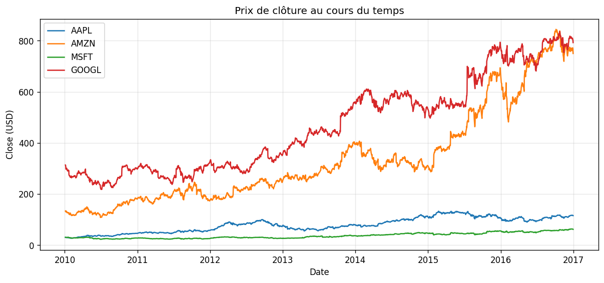

Les entreprises ont des niveaux de prix très différents et des tendances propres, avec une hausse globale sur la période.

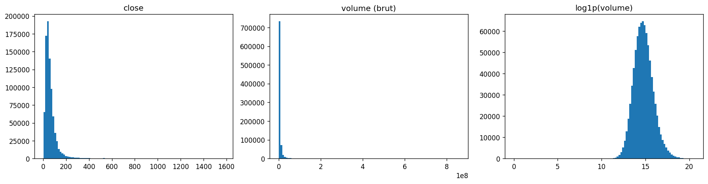

`close` et `volume` sont fortement asymétriques à droite. `log1p(volume)` est beaucoup plus symétrique, ce qui justifie la transformation logarithmique.

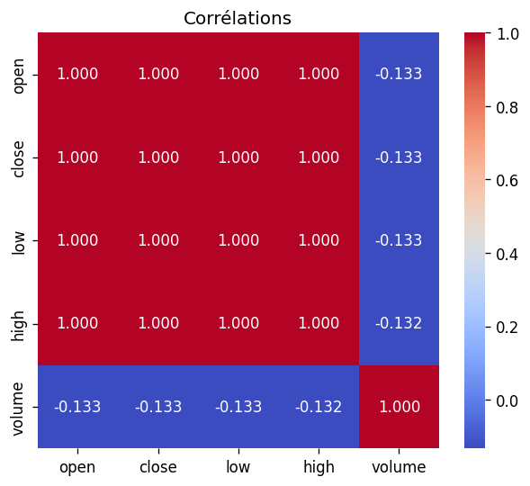

`open`, `high`, `low` et `close` sont corrélés à plus de 0,99, alors que le volume est faiblement corrélé aux prix. Le problème est donc presque linéaire.

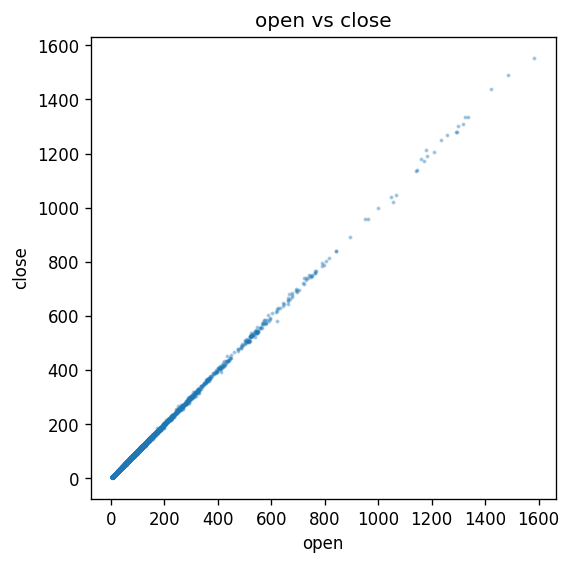

Les points forment presque une droite : le prix de clôture est très proche du prix d'ouverture du même jour.

## 1.2 Préparation des données
- Découpage **par date** (série temporelle) : entraînement avant 2016 (**725 139 lignes**), test à partir de 2016 (**126 125 lignes**).
- `StandardScaler` ajusté **uniquement sur le train**, appliqué aux variables et à la cible.
- Transformation `log1p` sur le volume.

## 1.3 Architecture
MLP **4 → 32 → 16 → 1** : activations ReLU, perte MSE, optimiseur Adam. Les options Dropout et BatchNorm sont activables pour la régularisation.

## 1.4 Recherche d'hyperparamètres (GridSearchCV + skorch)
Le modèle PyTorch est encapsulé dans `skorch.NeuralNetRegressor` pour être utilisé avec `GridSearchCV` (sous-échantillon de 50 000 lignes, 3 plis, 16 combinaisons).

| Hyperparamètre | Valeurs testées |
|---|---|
| Learning rate | 0.01, 0.001 |
| Optimiseur | Adam, SGD |
| Epochs | 20, 40 |
| Neurones (couche cachée) | 32, 64 |

Les 8 meilleures combinaisons (score = -MSE sur la cible standardisée) :

| lr | Optimiseur | Epochs | Neurones | Score moyen | Rang |
|---|---|---|---|---|---|
| 0.001 | Adam | 20 | 32 | -0.000212 | 1 |
| 0.001 | Adam | 40 | 32 | -0.000251 | 2 |
| 0.001 | Adam | 20 | 64 | -0.000272 | 3 |
| 0.001 | Adam | 40 | 64 | -0.000311 | 4 |
| 0.010 | Adam | 40 | 64 | -0.000353 | 5 |
| 0.010 | SGD | 40 | 64 | -0.000354 | 6 |
| 0.010 | SGD | 40 | 32 | -0.000371 | 7 |
| 0.010 | SGD | 20 | 64 | -0.000410 | 8 |

**Meilleure combinaison :** lr = 0.001, Adam, 20 epochs, 32 neurones (MSE standardisé de 0,0002, soit environ 0,02 % de la variance de `close`).

**Observations :** un learning rate faible avec Adam est le plus efficace. Un réseau plus petit (32 neurones) et moins d'epochs (20) font mieux que 64 neurones et 40 epochs : le problème est simple, donc une capacité supplémentaire n'apporte rien. Les écarts entre combinaisons restent très faibles.

**Limite :** `cv=3` ne respecte pas l'ordre temporel ; `TimeSeriesSplit` serait plus rigoureux.

## 1.5 Courbes Loss/Epochs et R²/Epochs
En régression, l'accuracy n'est pas définie : elle est remplacée par le **R²**.

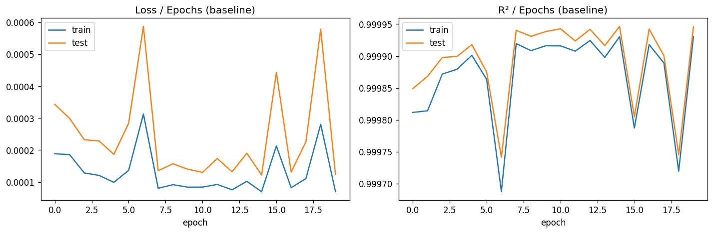

**Interprétation :**
- La loss (MSE sur cible standardisée) est déjà très faible dès la première epoch (train 1,9·10⁻⁴, test 3,4·10⁻⁴) et continue de diminuer jusqu'à l'epoch 20 (train 7,0·10⁻⁵, test 1,2·10⁻⁴).
- Le R² final est de 0,99993 sur le train et 0,99995 sur le test.
- La loss de test reste au-dessus de celle du train, mais l'écart est faible et elle continue de baisser : **pas de surapprentissage**.
- Le problème est quasi linéaire (`open`, `high` et `low` sont très proches de `close`), ce qui explique la convergence très rapide.

**Métriques du modèle de base (en dollars) :**

| Jeu | MSE | RMSE | MAE | R² |
|---|---|---|---|---|
| Train | 0.6124 | 0.7826 | 0.4102 | 0.99987 |
| Test | 1.0577 | 1.0285 | 0.5248 | 0.99990 |

L'erreur absolue moyenne est d'environ 0,52 $ sur le test. Le RMSE est plus élevé sur le test que sur le train, mais le R² y est légèrement meilleur, ce qui indique une variance de `close` plus grande sur la période de test.

## 1.6 Régularisation et comparaison
Techniques testées : Dropout (0.2), L2 / weight decay (1e-4), BatchNorm, Early stopping (patience 5) et une combinaison (Dropout + L2 + Early stopping).

| Modèle | Epochs | Train RMSE | Test RMSE | Test MAE | Test R² | Écart (test - train RMSE) |
|---|---|---|---|---|---|---|
| Baseline | 20 | 0.5731 | 0.7607 | 0.3923 | 0.9999 | 0.1876 |
| Dropout 0.2 | 20 | 3.8910 | 6.2907 | 2.2444 | 0.9963 | 2.3997 |
| L2 (wd=1e-4) | 20 | 0.6872 | 0.9093 | 0.4685 | 0.9999 | 0.2221 |
| BatchNorm | 20 | 3.3942 | 5.1039 | 2.5296 | 0.9976 | 1.7097 |
| Early stopping | 20 | 0.5731 | 0.7607 | 0.3923 | 0.9999 | 0.1876 |
| Combiné | 6 | 4.6309 | 7.6423 | 2.3953 | 0.9945 | 3.0114 |

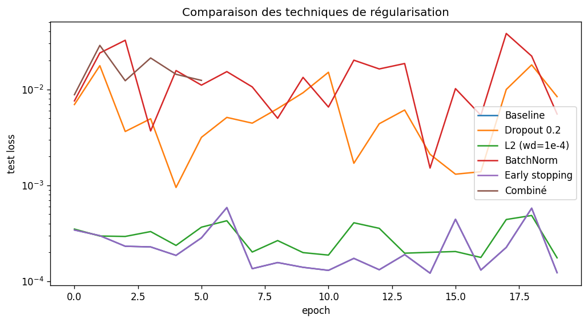

*Remarque : la baseline de ce tableau (RMSE test 0,76) diffère légèrement de celle de la section 1.5 (1,03) car il s'agit d'un nouvel entraînement : l'initialisation et le mélange des mini-batchs introduisent une variabilité. Les comparaisons se font au sein d'un même tableau.*

**Analyse :**
- **Aucune technique n'améliore la baseline.** Le modèle de base ne sur-apprend pas, donc la régularisation n'a rien à corriger.
- **Dropout et BatchNorm dégradent fortement les résultats** (RMSE test 6,29 et 5,10 contre 0,76). Le réseau est très petit et doit reproduire avec précision une relation presque linéaire : éteindre 20 % des neurones ajoute un bruit qui l'en empêche. Pour BatchNorm, l'écart entre statistiques de batch (entraînement) et statistiques cumulées (évaluation) peut aussi biaiser les prédictions. Ces modèles **sous-apprennent** (erreur élevée aussi sur le train) : l'écart plus grand n'indique pas un surapprentissage.
- **L2 (1e-4)** dégrade légèrement (RMSE 0,91 contre 0,76).
- **Early stopping** donne exactement la baseline : la loss de test baissait encore, l'arrêt ne s'est jamais déclenché.
- **Combiné** s'arrête à l'epoch 6 : le bruit du dropout rend la loss de test irrégulière, d'où un arrêt trop précoce et le pire résultat.
- En R², toutes les variantes restent au-dessus de 0,994.

## 1.7 Limites
- Tâche facile : prédire `close` à partir de `open/high/low` du même jour donne un R² très élevé.
- GridSearch sur un sous-échantillon, avec des plis qui ne respectent pas l'ordre temporel.
- L'early stopping surveille la loss de test ; il faudrait un jeu de validation séparé.
- Le test (année 2016) couvre une seule période de marché.
- Les résultats varient légèrement d'une exécution à l'autre.
- Une tâche plus réaliste serait de prédire le cours du lendemain à partir des jours précédents.

---

# Partie 2 : Classification multi-classes (Predictive Maintenance)

**Dataset :** [Machine Predictive Maintenance Classification](https://www.kaggle.com/datasets/shivamb/machine-predictive-maintenance-classification)

## Tâche
Prédire le type de panne (`Failure Type`) d'une machine à partir de `Type` (L/M/H) et de 5 mesures : températures de l'air et du processus, vitesse de rotation, couple, usure de l'outil.

## 2.1 Prétraitement
- 10 000 lignes, aucune valeur manquante. Suppression des identifiants `UDI` et `Product ID`.
- **27 lignes incohérentes supprimées** : 9 lignes `Target=1` sans type de panne (« No Failure ») et 18 « Random Failures » avec `Target=0`. Cela élimine la classe « Random Failures » (non prédictible, sans aucune ligne cohérente). **Il reste 9 973 lignes et 5 classes.**
- `Target` retirée des variables (version binaire du label : fuite d'information).
- `Type` encodé en ordinal (L=0, M=1, H=2) ; labels encodés par `LabelEncoder`.
- Découpage stratifié 80/20 (train 7 978, test 1 995), puis `StandardScaler` ajusté **sur le train uniquement**.

## 2.2 Analyse exploratoire
*(EDA réalisée sur les données brutes, avant suppression des 27 lignes incohérentes.)*

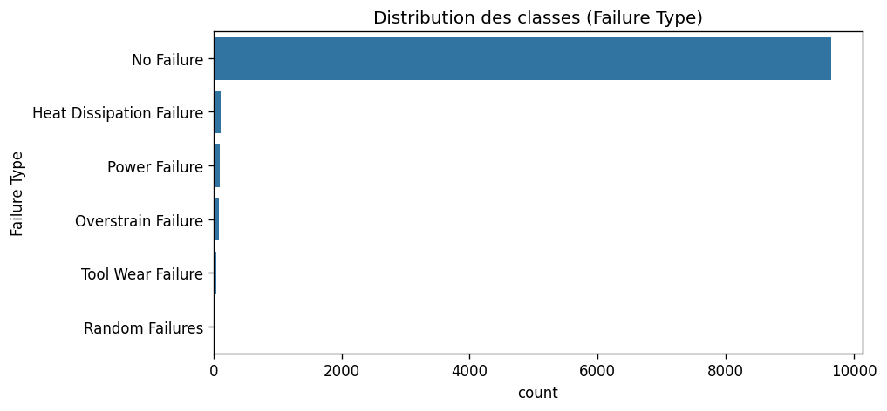

Déséquilibre extrême : « No Failure » = 9 652 lignes (96,5 %), Heat Dissipation 112, Power Failure 95, Overstrain 78, Tool Wear 45, Random Failures 18.

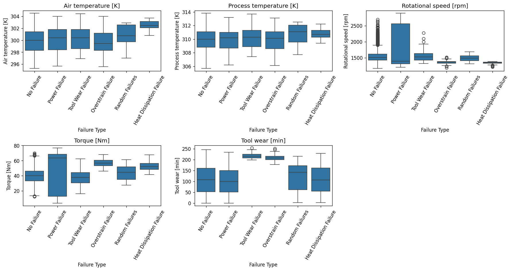

Chaque type de panne a une signature propre sur quelques variables. L'usure de l'outil identifie les pannes *Tool Wear* et *Overstrain* (≈ 210 à 220 min, très peu dispersées). Le couple élevé et la faible vitesse de rotation caractérisent *Overstrain* et *Heat Dissipation*, cette dernière étant aussi marquée par une température de l'air plus élevée. *Power Failure* se distingue par des vitesses et des couples très dispersés, avec des valeurs extrêmes. La température du processus discrimine peu. La classe « No Failure » couvre presque toutes les plages de valeurs, ce qui rend la frontière panne / pas de panne difficile. « Random Failures » ne se distingue pas de « No Failure », ce qui confirme qu'elle n'est pas prédictible.

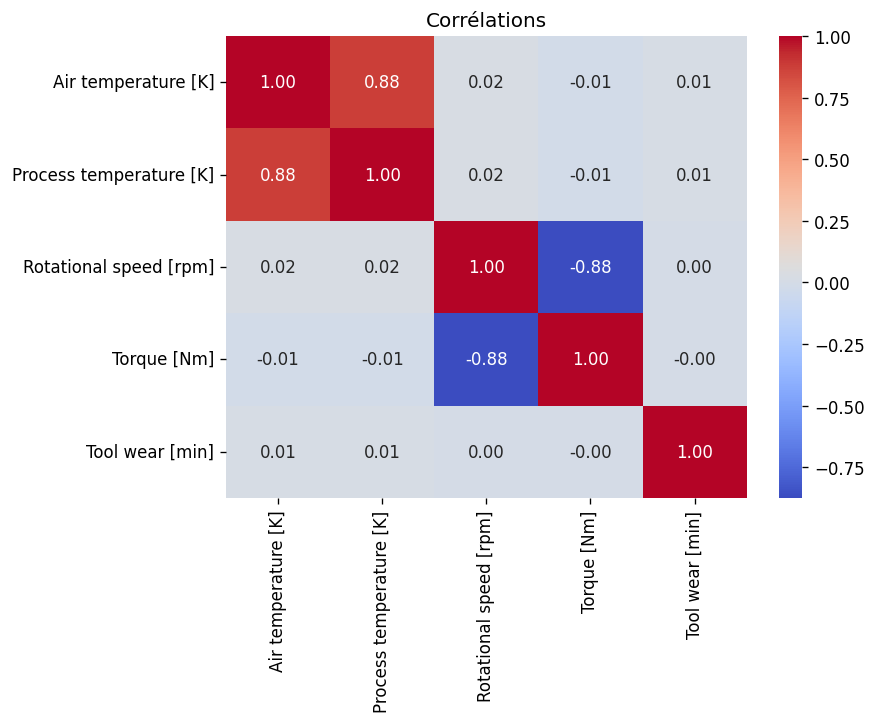

Les températures de l'air et du processus sont fortement corrélées ; la vitesse de rotation et le couple sont corrélés négativement.

## 2.3 Équilibrage par SMOTE
SMOTE (`k_neighbors=3`) est appliqué **au train uniquement** : avant `[90, 7714, 62, 76, 36]` (Heat, No Failure, Overstrain, Power, Tool Wear), après **7 714 par classe (38 570 lignes)**. Le test reste intact et déséquilibré.

## 2.4 Architecture
MLP **6 → 64 → 32 → 5**, ReLU, sortie en logits, perte `CrossEntropyLoss`.

## 2.5 Recherche d'hyperparamètres (GridSearchCV, score F1 macro, 3 plis)

| lr | Optimiseur | Epochs | Neurones | F1 macro CV | Rang |
|---|---|---|---|---|---|
| 0.001 | Adam | 40 | 64 | 0.9142 | 1 |
| 0.001 | Adam | 40 | 32 | 0.9036 | 2 |
| 0.010 | SGD | 40 | 32 | 0.8793 | 3 |
| 0.010 | SGD | 40 | 64 | 0.8746 | 4 |
| 0.001 | Adam | 20 | 64 | 0.8578 | 5 |
| 0.001 | Adam | 20 | 32 | 0.8564 | 6 |
| 0.001 | SGD | 40 | 64 | 0.8030 | 7 |
| 0.010 | SGD | 20 | 32 | 0.7839 | 8 |

**Meilleure combinaison :** lr = 0.001, Adam, 40 epochs, 64 neurones. Contrairement à la Partie 1, le plus grand réseau avec le plus d'epochs gagne : la tâche est plus complexe.

**Limites :** (1) la validation croisée porte sur des données déjà suréchantillonnées : des points synthétiques d'un même original se retrouvent dans le train et la validation, donc le score est **optimiste** ; (2) la meilleure valeur d'epochs est au bord de la grille.

## 2.6 Courbes Loss/Epochs et Accuracy/Epochs

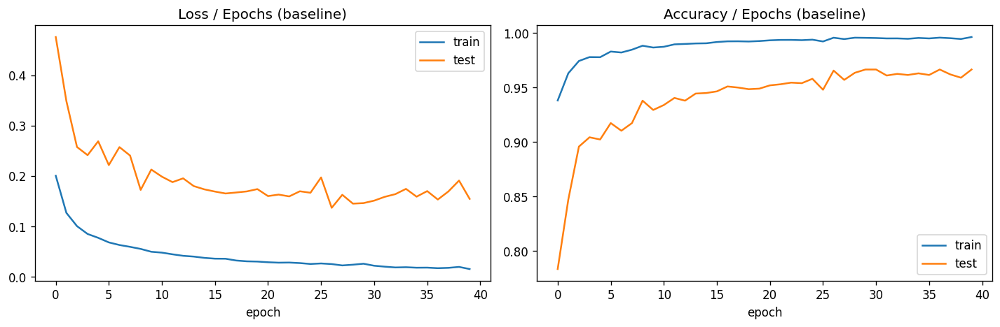

| | Epoch 1 | Epoch 40 |
|---|---|---|
| Loss train | 0.200 | 0.015 |
| Loss test | 0.476 | 0.155 |
| Accuracy train | 93.8 % | 99.6 % |
| Accuracy test | 78.3 % | 96.6 % |

**Interprétation :** les deux loss diminuent fortement, donc les 40 epochs étaient utiles. La loss test finale (0,155) vaut environ 10 fois la loss train (0,015) : signe d'un début de surapprentissage, à nuancer car le train est équilibré par SMOTE et le test ne l'est pas. L'accuracy test de 96,6 % est **trompeuse** : prédire toujours « No Failure » donnerait environ 96,7 %.

## 2.7 Métriques

| Métrique | Train (équilibré) | Test (déséquilibré) |
|---|---|---|
| Accuracy | 0.9962 | 0.9664 |
| Précision (macro) | 0.9962 | 0.6176 |
| Recall / sensibilité (macro) | 0.9962 | 0.7905 |
| F1 (macro) | 0.9962 | 0.6781 |

| Classe (test) | Précision | Recall | F1 | Support |
|---|---|---|---|---|
| Heat Dissipation | 0.62 | 0.82 | 0.71 | 22 |
| No Failure | 0.99 | 0.97 | 0.98 | 1929 |
| Overstrain | 0.74 | 0.88 | 0.80 | 16 |
| Power Failure | 0.62 | 0.84 | 0.71 | 19 |
| Tool Wear | 0.12 | 0.44 | 0.19 | 9 |

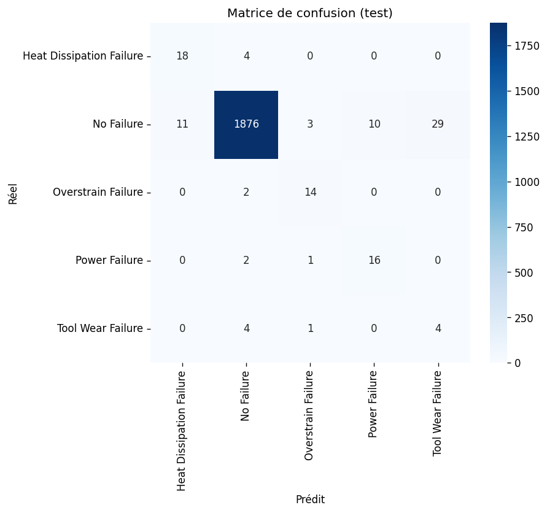

Les erreurs concernent surtout la frontière « No Failure » / pannes : 53 machines saines sur 1 929 (2,7 %) déclenchent une fausse alerte, dont 29 en « Tool Wear ». Les confusions entre types de panne sont quasi inexistantes. Le profil « recall élevé, précision plus faible » est typique de SMOTE et défendable en maintenance prédictive, où rater une panne coûte souvent plus cher qu'une fausse alerte. Le F1 macro test (0,68) est bien inférieur au F1 train (0,996) : les deux colonnes ne sont pas comparables (train équilibré avec points synthétiques, test réel). « Tool Wear » est la classe la plus faible (36 exemples réels en train, 9 en test).

## 2.8 Régularisation

| Modèle | Epochs | Train Acc | Test Acc | Précision macro | Recall macro | F1 macro |
|---|---|---|---|---|---|---|
| Baseline | 40 | 0.9962 | 0.9664 | 0.6176 | 0.7905 | 0.6781 |
| Dropout 0.2 | 40 | 0.9891 | 0.9333 | 0.5385 | 0.8749 | 0.6314 |
| L2 (1e-4) | 40 | 0.9948 | 0.9614 | 0.6115 | 0.8004 | 0.6741 |
| BatchNorm | 40 | 0.9957 | 0.9599 | 0.5864 | 0.7738 | 0.6477 |
| Early stopping | 14 | 0.9903 | 0.9444 | 0.5555 | 0.8804 | 0.6421 |
| Combiné | 29 | 0.9863 | 0.9243 | 0.5129 | 0.8971 | 0.6090 |

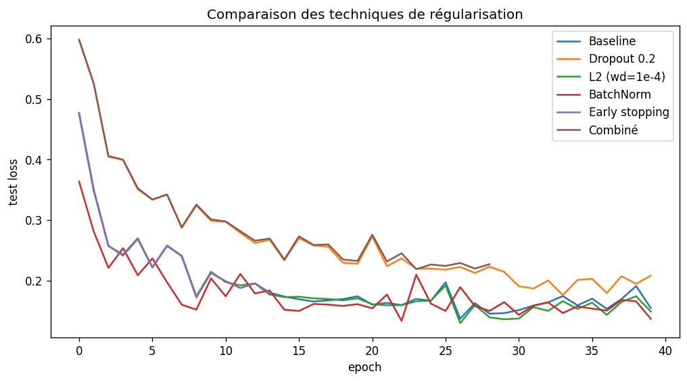

**Analyse :**
- Aucune technique n'améliore le F1 macro de la baseline (0,678). L2 est équivalent (0,674).
- Dropout, Early stopping et Combiné augmentent le recall macro (jusqu'à 0,897) mais font chuter la précision (jusqu'à 0,51) : plus de pannes détectées, mais plus de fausses alertes. Si une panne manquée coûte beaucoup plus cher qu'une fausse alerte, ces variantes peuvent être préférables.
- L'early stopping s'arrête à l'epoch 14 alors que les autres courbes continuent de baisser jusqu'à l'epoch 40 : la loss test est très bruitée, d'où un arrêt prématuré.
- La loss test ne remonte pas nettement : pas de surapprentissage marqué sur la loss.
- Le test contient 9 « Tool Wear » et 16 « Overstrain » : un seul exemple change sensiblement le F1 macro, et une seule graine a été utilisée. Les écarts entre baseline, L2 et BatchNorm sont trop faibles pour conclure.

## 2.9 Limites
- Scores de validation croisée optimistes (SMOTE appliqué avant la CV).
- Classes rares : très peu d'exemples réels (36 « Tool Wear » en train), SMOTE interpole entre très peu de points.
- Test très petit pour les classes rares, scores instables, une seule graine.
- Early stopping basé sur la loss test et non sur un jeu de validation.
- Suppression de la classe « Random Failures ».
- Non testé : poids de classes dans la perte à la place de SMOTE.

---

# Synthèse personnelle

- J'ai appris à standardiser avec les statistiques du jeu d'entraînement uniquement, et à découper par date pour une série temporelle afin d'éviter toute fuite d'information.
- J'ai appris à utiliser skorch pour intégrer un modèle PyTorch dans `GridSearchCV`, et j'ai mesuré le coût en temps d'une recherche d'hyperparamètres.
- J'ai appris à lire les courbes de loss pour diagnostiquer le surapprentissage (absent en Partie 1, début de surapprentissage en Partie 2).
- J'ai compris que l'accuracy n'a pas de sens en régression (on utilise R², RMSE, MAE) et qu'elle est trompeuse sur des classes déséquilibrées (on regarde F1 macro et recall par classe).
- J'ai appliqué SMOTE uniquement sur le train, après le découpage et la standardisation, et constaté que la validation croisée sur données suréchantillonnées est optimiste.
- J'ai constaté que la régularisation n'améliore pas toujours le résultat : en Partie 1, Dropout et BatchNorm ont dégradé un modèle déjà sans surapprentissage ; en Partie 2, elle déplace surtout le compromis recall / précision.
- J'ai appris à lire une matrice de confusion pour localiser les erreurs (ici, la frontière panne / pas de panne).
